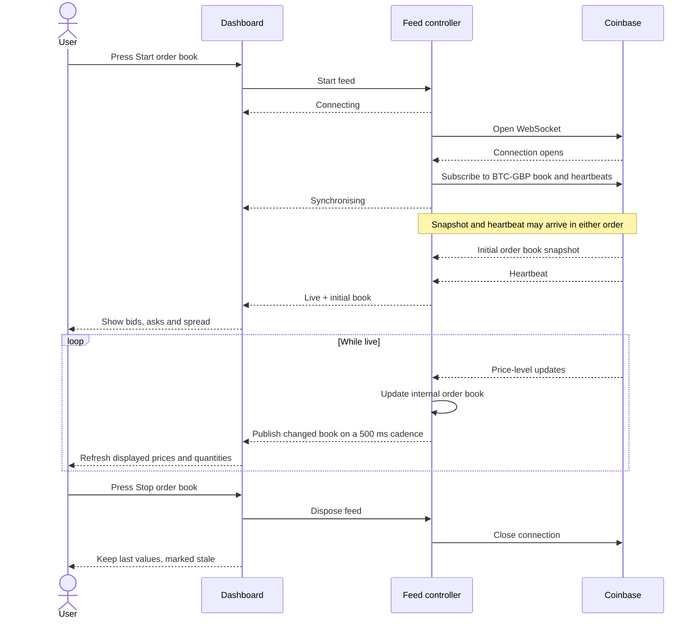

# Market Dashboard

A React + TypeScript order book built with Vite and Tailwind CSS. This project
was created to familiarise myself with the world of web sockets, high volume
data and maintaining an accurate display. The journal.md at the root has been
written completely by myself and agents have been instructed not to touch it. It
contains the notes I took throughout this project, explaining every decision,
feature and tradeoff made when developing the app.

## Development

Use Node.js 24 and npm. Run commands from the project directory:

| Command                        | Purpose                                                         |
| ------------------------------ | --------------------------------------------------------------- |
| `npm run dev`                  | Start the development server.                                   |
| `npm run lint`                 | Run ESLint.                                                     |
| `npm test`                     | Run unit and integration tests once, using fake sockets.        |
| `npm run test:watch`           | Rerun tests as files change.                                    |
| `npm test -- src/App.test.tsx` | Run the dashboard acceptance tests only.                        |
| `npm run build`                | Check TypeScript and build production files in `dist/`.         |
| `npm run preview`              | Serve the last production build locally; rebuild after changes. |

Run **`npm run perf`** with Google Chrome installed to benchmark the full
Dashboard offline. It builds the app and runs baseline and stress workloads once
each. Allow about 75 seconds, longer under overload. The terminal summary and
`output/playwright/profile/latest.md` report freshness, main-thread blocking,
CPU work and initial snapshot processing, with pass/fail budgets. A failed
budget returns exit code 1 after saving results. Use
`npm run perf -- --repeat 3` for three repetitions each (about four minutes).
See the [benchmark protocol](src/dev/benchmark-fixtures.md) for inputs,
definitions and limitations. No exchange connection or fixture-generation
command is needed.

## How it works

Many crypto exchanges offer a free tier web socket api that provides high
volume, streamable data. The data in particular that this application is built
for is called an orderbook. An orderbook tracks the bids (how much someone is
willing to pay) and the asks (how much someone is willing to sell for) for an
underlying asset. The range of assets they can work with is wide but in this
project we're working with cryptocurrencies.

The journey begins at the Start/Stop control on Dashboard.tsx. On start, a
change in state travels through the Dashboard then through App.tsx where it
reaches the useOrderBook hook and enables the feed. This hook is the bridge
between React state and the feed controller. The controller has many
responsibilities. Once it opens the WebSocket with Coinbase successfully, it
sends a subscribe type message to request the BTC-GBP product from Coinbase.
This product includes two channels: an initial orderbook object of type
'snapshot', containing a relatively high volume of bids and asks, alongside a
'heartbeat' type message. The heartbeats indicate the connection is healthy and
power the pulse animation inside the diagnostics panel on the main dashboard.
This is so users can be confident the connection is working if prices aren't
moving or look static (introduced this feature when wondering if the app was
broken when viewing on a quiet Saturday morning.)

The third type of message that comes from Coinbase is 'l2update' which can
happen up to 20 times per second, or every 50 ms, and includes the latest
quantities associated with each price level. The controller ingests the initial
snapshot and decodes the content within - which means it combs through what is
being sent over, validates that it is data that is expected then sorts it into a
suitable category. Once messages are decoded, snapshot type messages are sent
over to an order book function which maintains a working book object. This
entails storing the prices into a map. It does this by using prices as canonical
keys. Therefore, when new quantities come in for a specific price in the form of
an l2update message, the map allows efficient lookup and replacement by price. A
price that doesn't exist on the map gets added new, and if it already exists
then the price is updated with the new quantity. 0 quantities are how Coinbase
communicates that a price no longer exists on the orderbook, so these remove the
level entirely.

An initial snapshot, once decoded and confirmed with a healthy heartbeat, is
published immediately, then the working orderbook is maintained with every
update that comes in. Every 500 ms it copies a snapshot of the working book then
sends the published book over to the Dashboard. The reason it does this is to
ensure that incoming price updates don't mutate the book object being sent over
to the view calculations. Once the Dashboard receives the published book, it
passes it through the view function which takes the top 10 prices, accounts for
any grouping options, sorts the data into best prices, then produces display
data, like rows of prices, labels and spread.

The view calculation is memoized because it sits under the Dashboard parent
which is also responsible for the heartbeat animation - fuelled by the heartbeat
channel. The heartbeats come in every ~ 1 s from coinbase to indicate that a
connection is healthy, and increments a counter to trigger a React render. This
causes Dashboard to update which would usually trigger a recalculation of the
view, but memoization prevents this from happening. This way, the Dashboard can
update and render the heartbeat animation with incoming heartbeat messages,
without computing the view more often than it needs to.

The view calculation entails taking the published version of the book (the one
that is copied in the controller) then sorting the best 10 prices. It does this
by storing an array of the first 10 prices, then comparing each new price
against this top 10. If the new price is better, it is sliced into the
appropriate ranking. This way, the entire book isn't sorted, only the top 10 are
in the relevant order but unnecessary work is avoided while accounting for each
price in the book. If grouping is turned on, a slightly different method is used
in that the prices are all placed into buckets which groups them to the nearest
relevant boundary then sums the quantities. For example, if £10 grouping is
selected and a bid of £111 is being considered, then it is placed in the £110
boundary because we don't want the Dashboard to show better prices than reality.
Similarly, if an ask of £111 exists, then it would be grouped into the £120
boundary. The buckets are then spread into an array and sorted best to worst,
then sliced of the top 10 to produce the rows.
