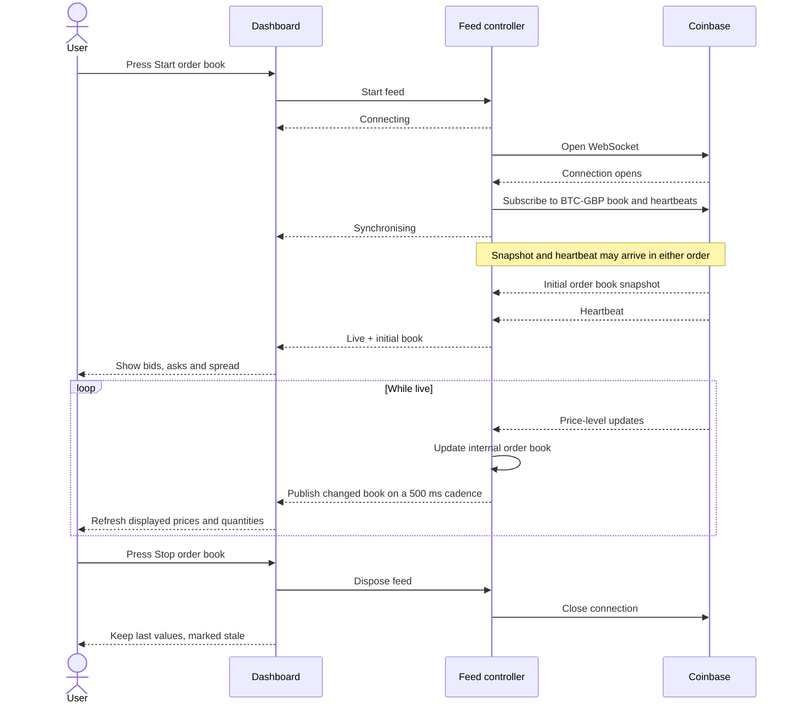

# Market Dashboard

A React + TypeScript order book built with Vite and Tailwind CSS. This project
was created to familiarise myself with the world of web sockets, high volume
data and maintaining an accurate display. The journal.md at the root has been
written completely by myself and agents have been instructed not to touch it. It
contains the notes I took throughout this project, explaining every decision,
feature and tradeoff made when developing the app.

## Development

Use Node.js 24 and npm. Run commands from the project directory:

| Command                        | Purpose                                                         |
| ------------------------------ | --------------------------------------------------------------- |
| `npm run dev`                  | Start the development server.                                   |
| `npm run lint`                 | Run ESLint.                                                     |
| `npm test`                     | Run unit and integration tests once, using fake sockets.        |
| `npm run test:watch`           | Rerun tests as files change.                                    |
| `npm test -- src/App.test.tsx` | Run the dashboard acceptance tests only.                        |
| `npm run build`                | Check TypeScript and build production files in `dist/`.         |
| `npm run preview`              | Serve the last production build locally; rebuild after changes. |

Run **`npm run perf`** with Google Chrome installed to benchmark the full
Dashboard offline. It builds the app and runs baseline and stress workloads once
each. Allow about 75 seconds, longer under overload. The terminal summary and
`output/playwright/profile/latest.md` report freshness, main-thread blocking,
CPU work and initial snapshot processing, with pass/fail budgets. A failed
budget returns exit code 1 after saving results. Use
`npm run perf -- --repeat 3` for three repetitions each (about four minutes).
See the [benchmark protocol](src/dev/benchmark-fixtures.md) for inputs,
definitions and limitations. No exchange connection or fixture-generation
command is needed.

## How it works

An order book tracks the bids (how much someone is willing to pay) and the
asks (how much someone is willing to sell for) for an asset. In this project
we're looking at Bitcoin, priced in GBP, using Coinbase's live feed.

The journey begins at the Start/Stop control on the Dashboard. Pressing Start
changes the enabled state in `App.tsx`, which tells `useOrderBook` to start the
feed controller. This hook is the bridge between React and the controller - it
manages the controller's lifetime and stores the state it publishes for the
Dashboard to use.

The controller lives in `bookFeed.ts`. It opens a WebSocket with Coinbase, then
subscribes to the `level2_batch` and `heartbeat` channels for BTC-GBP. The status
moves from Connecting to Synchronising while it waits for an initial `snapshot`
and a heartbeat. Once both have arrived, it marks the feed Live and publishes
the initial book immediately.

Incoming messages are parsed and validated before being applied to the working
book, which stores bids and asks in separate maps using canonical price keys.
This allows efficient lookup and replacement by price. `l2update` messages add
new levels or replace existing quantities, while a quantity of 0 removes the
level entirely. `big.js` handles decimal arithmetic so prices and quantities
aren't affected by typical floating point rounding errors.

The working book is maintained outside React with every accepted update. When
there is new data, the controller publishes a copy on a 500 ms cadence. This
limits how often the Dashboard recalculates its view, and copying the maps
means incoming updates don't mutate the book being used for those calculations.

The view calculation scans the published book using a custom top-k selection
algorithm, keeping the best 10 prices per side without sorting the entire book.
Grouping instead builds buckets from the full book and sums their quantities.
With £10 grouping, a bid at £111 goes into the £110 bucket, while an ask at £111
goes into the £120 bucket. Bids round down and asks round up because we don't
want to show better prices than reality. The best 10 buckets become the rows,
while best bid, best ask and spread still use exact prices.

Heartbeats power the pulse animation in the diagnostics panel. I introduced
this after wondering if the app was broken on a quiet Saturday morning when
prices weren't moving. Heartbeats update a counter without changing the
published book or receipt time. The view calculation is memoized against the
book, receipt time and grouping interval, so these renders don't repeat that
work. The receipt label shows when the last accepted book message was received
locally, in UTC. It isn't an exchange timestamp or a latency measurement.

Pressing Stop closes the connection and clears the controller's timers, keeping
the last displayed values marked stale. Failures also mark values stale while
the controller retries with increasing, randomised delays. Each new connection
rebuilds the book from a fresh snapshot and waits for a heartbeat before
returning to Live. Hiding the tab suspends the feed, returning starts a fresh
connection, and going offline pauses retries until the browser is online again.
