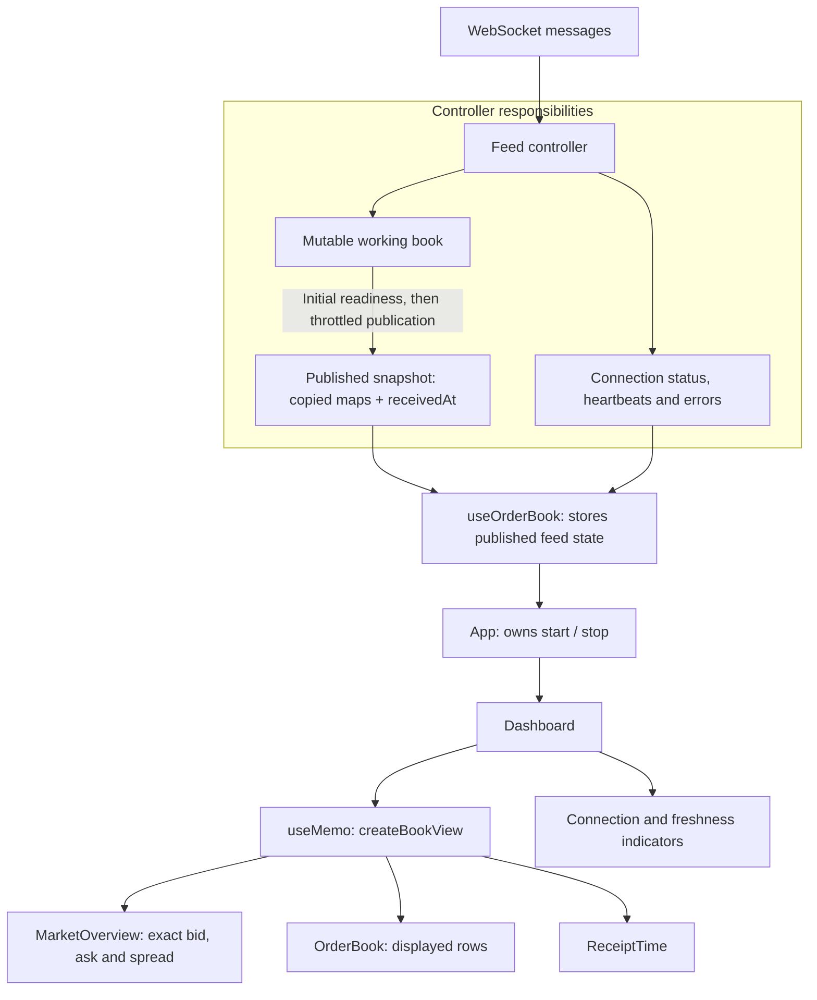

# Journal figures

## Feed-to-view data flow

From [journal step 20a](journal.md#step-20a).

## Performance comparison runs

From [journal step 21](journal.md#step-21). Recorded 12 October 2026.
These repeated measurements replace the three earlier single-run tables.

### Method

30 completed browser runs: ten scenarios, three repetitions each. Apple M1 (8 logical CPUs), 16 GiB RAM, macOS 15.3.1, headless Chrome 155.0.8059.40, 1440 × 1000 viewport. Vite development build, Strict Mode off; isolated cache and hot reload disabled. Scenarios ran in forward, reverse and rotated order, with a fresh browser context per run. External requests were blocked.

Each run offered 20 updates/sec and published every ten updates (500 ms target), discarded five warm-up publication windows, then measured 30 windows / 300 updates. Depth is per side; changes are combined across both sides. Grouping is £10 unless off. The alternatives ran inside the paced decode → apply → copy → view → React/DOM pipeline. Separate algorithm comparisons were disabled.

**Reading the tables:** work is the median of three per-run medians; parentheses give their minimum–maximum range. Delivery is the median run rate. Publication p95 is the median of the three per-run p95 values. Worst lateness is the largest schedule delay across all three runs. Times are milliseconds. These are not pooled percentiles or confidence intervals.

The initial book had integer bid prices `65000 - slot`, ask prices `65001 + slot`, and quantity `1`. A Fisher–Yates shuffle used seed 42 and the recurrence `(1664525 × seed + 1013904223) mod 2^32`. Update slots used `(update × 101 + entry × 37) mod depth`; quantities cycled from 2 to 18. Replacements and remove/reinsert pairs preserved depth. Both book sides were measured.

The first pass ran current baseline, current deep book, current unthrottled stress, current throttled stress, baseline grouping off, baseline Number, baseline bounded selection, throttled grouping off, throttled Number, and throttled bounded selection. The second pass reversed that order; the third moved the final five scenarios before the first five. CPU slowdown was applied with Chrome DevTools Protocol's `Emulation.setCPUThrottlingRate`, using rate 1 or 4. Playwright drove local Chrome; no exchange connection was used.

Updates used absolute 50 ms deadlines. Late updates stayed queued without dropping or moving the deadlines, so overload accumulated lateness. The production decoder, book mutation, snapshot copying, view calculation and OrderBook component were used. A separate React root rendered the OrderBook through `flushSync`; the benchmark did not mount the full Dashboard. The five warm-up windows ran the same workload but their timings were discarded.

### Capacity with the current implementation

| Depth / changes / CPU slowdown |     Work ms (range) | Updates/sec | Publication p95 ms | Worst lateness ms |
| ------------------------------ | ------------------: | ----------: | -----------------: | ----------------: |
| 1,000 / 20 / 1×                |    25.6 (16.5–25.7) |       20.00 |              512.3 |               2.9 |
| 10,000 / 20 / 1×               |   79.8 (77.0–109.0) |       20.04 |              536.9 |              66.3 |
| 10,000 / 10,000 / 1×           | 190.6 (179.2–193.3) |       20.04 |              514.5 |              65.5 |
| 10,000 / 10,000 / 4×           | 610.7 (601.4–619.0) |       14.84 |              715.8 |            7032.5 |

### Alternatives inside the paced run

Baseline: 1,000 levels/side, 20 changes/update, no CPU slowdown. Stress: 10,000 levels/side, 10,000 changes/update, 4× slowdown. Negative work change means less work than the current method in the same case; percentages compare the aggregate medians.

| Case     | Grouping method          |     Work ms (range) | Work change | Updates/sec |
| -------- | ------------------------ | ------------------: | ----------: | ----------: |
| Baseline | Current Big.js + sort    |    25.6 (16.5–25.7) |           — |       20.00 |
| Baseline | Number prices + sort     |    21.8 (21.1–22.0) |      -14.8% |       20.00 |
| Baseline | Big.js + bounded top ten |    25.7 (17.2–26.0) |       +0.4% |       20.00 |
| Baseline | Grouping off             |    19.2 (12.9–19.4) |      -25.0% |       20.00 |
| Stress   | Current Big.js + sort    | 610.7 (601.4–619.0) |           — |       14.84 |
| Stress   | Number prices + sort     | 532.6 (517.7–539.4) |      -12.8% |       16.77 |
| Stress   | Big.js + bounded top ten | 594.2 (594.0–612.0) |       -2.7% |       15.14 |
| Stress   | Grouping off             | 491.9 (486.6–493.4) |      -19.5% |       17.85 |

Only grouping changed between algorithm variants. Current grouping used Big.js price boundaries and full bucket sorting. The Number variant computed bid boundaries with `floor(price / interval) × interval` and ask boundaries with `ceil(price / interval) × interval`, converting the result back to a string. Quantity arithmetic remained decimal. Bounded selection retained at most ten sorted buckets instead of sorting all buckets; it used the same decimal comparator and Big.js aggregation. Exact headline prices still came from the original raw-level selection. Grouping off displayed raw levels, so it was a diagnostic comparison with different display behaviour.

### Correctness checks

| Deliberate cases                                                        | Big.js + bounded top ten | Number prices + sort                 |
| ----------------------------------------------------------------------- | ------------------------ | ------------------------------------ |
| Shuffled integers; more than ten buckets                                | Pass                     | Pass                                 |
| Fractional prices below/on/above £10, £100 and £1,000 boundaries        | Pass                     | Pass                                 |
| Quantity replacements, deletions and exact decimal totals on both sides | Pass                     | Pass                                 |
| Empty book and one empty side                                           | Pass                     | Pass                                 |
| High-precision prices immediately around those three boundaries         | Pass                     | **Fail: wrong bucket on both sides** |

Deterministic checks compared complete views: bucket membership, row order, quantities, labels, proportions and exact headline prices. They covered shuffled integer books with more than ten buckets; prices 0.01 below, exactly on and 0.01 above £10, £100 and £1,000; decimal quantity replacements and deletions on both sides; empty books; one empty side; and grouping off. Additional cases used prices immediately below/above those boundaries beyond Number's precision.

For example, with £10 grouping, bid `9.999999999999999999` belongs in bucket `0`, but Number placed it in `10`; ask `10.000000000000000001` belongs in `20`, but Number placed it in `10`. Headlines remained exact. These expected differences were asserted by the tests; “Fail” in the table means the algorithm failed equivalence, not that the test suite failed. At the time of the experiments, 64 focused tests, the TypeScript/production build and ESLint passed.

### Measurement definitions and limitations

- Work sums ten decode/apply operations and one copy/view/render, including timing overhead. Fixture generation, waiting, layout and paint are excluded from this sum. Elapsed publication windows also include waiting and fixture generation. Individual operation timings overlap the work total and must not be added to it.
- Publication intervals are measured between completed synchronous commits. Delivery rate uses the 299 gaps between the first and last of the 300 measured updates. Worst lateness compares delivery time with its scheduled deadline; backlog may already exist after warm-up.
- Per-run median and p95 use nearest-rank selection. The tables aggregate run summaries rather than pooling individual timing samples. Raw individual samples were not retained. Work ranges show variation between run medians, not within-run minima and maxima.
- Integer prices, one shuffle, regular arrivals and constant depth do not reproduce the full distribution of live traffic. The baseline batch size follows earlier observations of roughly 10–20 changes/update. Browser CPU slowdown does not represent a separate physical device.
- Some medians varied substantially despite warm-up; JIT, garbage collection and background scheduling were not isolated. These development timings exclude interaction latency and the real feed scheduler. They are not production latency measurements or directly comparable with the earlier manual runs.

### Future measurements

The retained harness at `/fixtures.html?load` measures the current production algorithms with independent depth, update-size and grouping controls. Run it with `npm run dev`, keep the tab visible, and optionally apply DevTools CPU throttling before starting. Record the settings and repeat runs before comparing results. The one-off Number and bounded-selection implementations have been removed; the tables above record those historical experiments. Optional browser automation and the original per-run JSON remain local and ignored.
